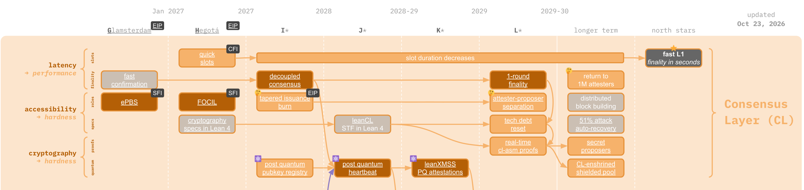

# cl-asm

**A path toward a formally verified canonical RISC-V guest for Ethereum's consensus-layer state transition.**

`cl-asm`—short for **CL in assembly**—is a proposal for making the consensus-layer state transition function (CL STF) provable by construction. The intended end state is a canonical RISC-V program, formally shown equivalent to a formal CL specification, whose executions can be proven by a zkVM and cheaply verified by light clients and attesters.

> [!IMPORTANT]
> This repository is an experimental precursor to that vision. Lean proves the modeled instruction sequence for one operation from today's consensus specification—not the generated ELF or the ZisK guest. The repository does not yet implement the future full CL STF or achieve real-time proving.

[](https://strawmap.org)

*Static crop of the Consensus Layer band from the [public source drawing](https://docs.google.com/drawings/d/1GkcGfQv9kxgrYQMyu0BYGcZya0gIDG_wQ7GsFJEsdzY/edit?usp=sharing) linked by [strawmap.org](https://strawmap.org); cropped without other edits. The live strawmap is a work-in-progress coordination document, not a finalized schedule or prediction.*

## The proposal

The [cl-asm light-client proposal](https://notes.ethereum.org/A47R_en0TVqAiE_5c_r4bA?view) describes the consensus-layer counterpart to [`evm-asm`](https://github.com/Verified-zkEVM/evm-asm):

1. Define the CL STF in a formal language such as Lean 4 or Sail.
2. Implement a canonical guest program directly in RISC-V assembly.
3. Prove that the guest implements the formal CL STF.
4. Execute the guest in a zkVM to produce a succinct proof of each transition.
5. Let light clients and attesters verify the proof instead of re-executing or trusting a specialized committee.

```text
formal CL specification
          │ equivalence proof
          ▼
 canonical RISC-V CL STF ──execution──► zkVM prover
          │                                  │
          └──────── public transition ───────┤
                                             ▼
                                      succinct CL proof
                                             │
                          light clients and attesters verify
```

The proposal targets deployment around the future **L\*** upgrade. That target is directional rather than a commitment: both the protocol design and the strawmap remain active research.

## From sync committees to real-time proofs

Ethereum light clients currently rely on BLS-based sync committees to authenticate finalized headers. The cl-asm vision replaces that special trust path with a proof of the CL state transition itself.

“Real-time” has a concrete aspiration: a high-end laptop CPU should produce a cl-asm proof with no more than one slot of latency. Reaching that goal requires more than optimizing a prover. The CL STF must also be redesigned for proof efficiency through the proposed [tech-debt reset](https://notes.ethereum.org/@JustinDrake/BkPH7AXSfl), including simpler state, accounting, queues, committees, cryptography, and proof-friendly commitments.

The result would separate two claims cleanly:

- the zkVM proves that the canonical guest executed correctly; and
- the formal proof establishes that the guest implements the specified CL transition.

## Place in the Ethereum strawmap

The captured [L1 Strawmap](https://strawmap.org) revision places cl-asm on a longer Consensus Layer research throughline:

```text
cryptography specs in Lean 4
          ↓
leanCL STF in Lean 4
          ↓
CL tech-debt reset ──► real-time cl-asm proofs
                              │
                              ├──► secret proposers
                              └──► CL-enshrined shielded pool
```

In this framing, cl-asm is not only a light-client mechanism. A small, canonical, proof-friendly CL transition can become shared infrastructure for:

- replacing sync committees with state-transition proofs;
- secret proposer mechanisms and single secret leader election (SSLE);
- a consensus-layer-enshrined privacy pool;
- stateless or proof-carried validator accounting; and
- an “extremely lean” chain with substantially less persistent consensus state.

These are potential downstream applications, not features implemented by this repository. See [The Extremely Lean Chain](https://ethresear.ch/t/the-extremely-lean-chain/25369) for the broader state-minimization and privacy direction.

## What this repository proves today

The current prototype applies the proposed method to Phase 0's `weigh_justification_and_finalization` operation. It is deliberately narrow enough to validate the complete proof-to-execution pipeline before attempting a full CL STF.

| | Long-term cl-asm vision | Current repository |
|---|---|---|
| Protocol scope | A future proof-friendly CL STF | One current justification/finalization operation |
| Guest artifact | Canonical RISC-V CL guest | 175-instruction, 700-byte RV64 routine |
| Formal claim | Equivalence to the complete formal CL specification | Lean contract for the routine's state update, resource preservation, and bounded return |
| Proof latency | At most one slot on a high-end laptop CPU | Not yet demonstrated |
| Network role | Real-time proofs for light clients and attesters | Research prototype and zkVM measurement target |

The guest generator copies the exact 700-byte routine from `weigh.elf` into a `.text.weigh` section of a separate ZisK guest; its C wrapper prepares inputs and commits public outputs. Lean proves the modeled instruction sequence; tests cover ELF generation, loading, byte consistency, official-reference behavior, and the zkVM wrapper. The emitter, assembler, linker, loader, and ELF-to-model correspondence remain outside the formal proof boundary.

## Technical record

- [`DESIGN.md`](DESIGN.md) — v0 scope, ABI, memory layout, and trust boundaries
- [`docs/roadmap.md`](docs/roadmap.md) — the path from the current operation to a proof-carrying CL STF
- [`docs/weigh.md`](docs/weigh.md) — whole-routine contract and validation
- [`docs/benchmarks.md`](docs/benchmarks.md) — interpreter and ZisK measurements
- [`docs/build.md`](docs/build.md) — reproducible build and test instructions

## Primary references

- [cl-asm light client proofs](https://notes.ethereum.org/A47R_en0TVqAiE_5c_r4bA?view)
- [Ethereum L1 Strawmap](https://strawmap.org)
- [CL tech-debt reset](https://notes.ethereum.org/@JustinDrake/BkPH7AXSfl)
- [The Extremely Lean Chain](https://ethresear.ch/t/the-extremely-lean-chain/25369)
- [`evm-asm`](https://github.com/Verified-zkEVM/evm-asm)
